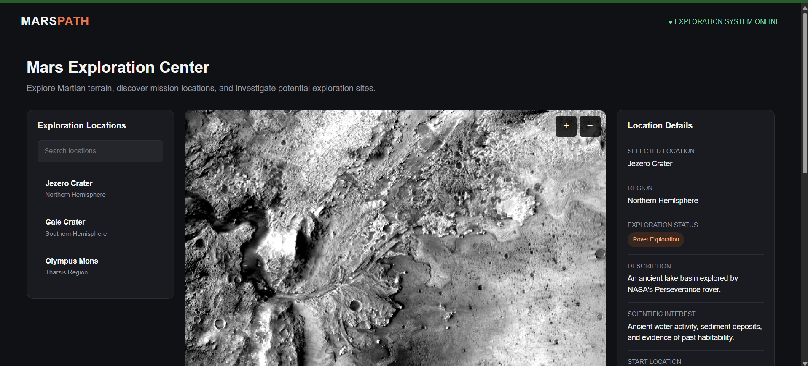

# MarsPath

MarsPath is a mission-planning prototype built for the NASA Space Apps Challenge.

The application allows users to explore key Martian locations using NASA-derived imagery and metadata, calculate distances between exploration sites, and evaluate scientific and environmental characteristics of potential mission destinations.

---

## Features

- Interactive Mars location explorer
- NASA-derived Mars imagery integration
- Searchable exploration locations
- Route planning between mission sites
- Mars-distance calculations using planetary coordinates
- Zoomable map interface
- Scientific and environmental metadata
- Spring Boot REST API backend
- Responsive web dashboard

---

## Data Sources

This project incorporates map products and metadata derived from:

- NASA Mars Trek
- Mars Reconnaissance Orbiter (MRO)
- Context Camera (CTX) map products

Source references and metadata are included within the application.

---

## Technology Stack

### Backend

- Java 21
- Spring Boot
- Jackson JSON Processing
- Maven

### Frontend

- HTML
- CSS
- JavaScript

### Data

- NASA Mars imagery (PNG conversions)
- JSON metadata repository

---

## Installation

### Prerequisites

Install the following:

- Java 21+
- Maven 3.9+
- Git

Verify your installations:

```bash
java -version
mvn -version
git --version
```

---

## Clone Repository

```bash
git clone "https://github.com/cschleyer-2004/mars-path"
cd mars-path
```


---

## Build the Project

```bash
mvn clean package
```

---

## Run the Application

### Option 1: Maven

```bash
mvn spring-boot:run
```

### Option 2: Run the packaged JAR

```bash
java -jar target/*.jar
```

---

## Open Application

Once the application is running, navigate to:

```text
http://localhost:8080
```

API endpoint:

```text
http://localhost:8080/api/v1/mars/locations
```

---

## Project Structure

```text
src/main/
├── java/
│   └── com.nasacyberchallengeapp/
│       ├── controller/
│       ├── model/
│       │   ├── Bounds.java
│       │   └── Location.java
│       ├── repository/
│       ├── service/
│       └── App.java
│
├── resources/
│   ├── data/
│   │   └── locations.json
│   │
│   ├── static/
│   │   ├── maps/
│   │   ├── script.js
│   │   └── styles.css
│   │
│   └── templates/
│       └── index.html
│
pom.xml
```

---

## Route Planning

MarsPath includes mission-route planning between Martian exploration sites.

Current features include:

- Starting location selection
- Destination selection
- Surface distance estimation
- Destination terrain information
- Radiation risk information
- Mission transport recommendations

Distances are calculated using Martian latitude and longitude coordinates.

---

## Screenshots

Add screenshots of the application before submission.

### Main Dashboard



### Route Planning


---

## Super Intelligence (SI) Disclosure

Super Intelligence (SI) tools were used during development for:

- Software engineering assistance
- Debugging support
- Frontend development guidance
- API integration assistance
- Route-planning calculations
- Documentation support

SI tools were not used to generate the NASA imagery or NASA-derived source metadata used in the application.

---

## Future Improvements

Potential future enhancements include:

- Additional NASA data layers
- Elevation overlays
- Atmospheric condition mapping
- Radiation heatmaps
- Rover traverse visualization
- Dynamic route optimization
- Real GIS tile rendering

---

## License

This repository is provided for educational and demonstration purposes.